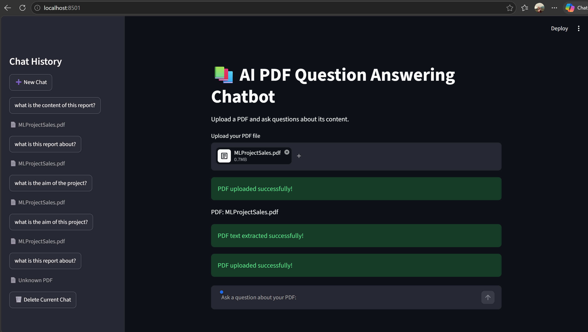
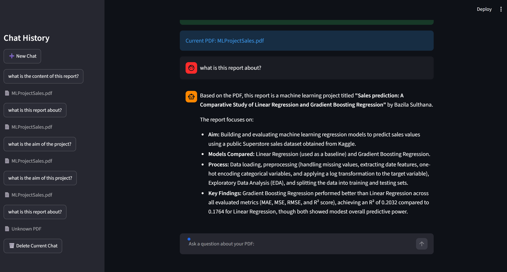

AI-Powered PDF Question Answering Chatbot

An AI-powered application that allows users to upload PDF documents and ask questions about their content. The application uses Google Gemini AI to generate answers based on the uploaded PDF.

Features

- Upload PDF documents.
- Extract text from PDF files using PyPDF.
- Ask questions about PDF content.
- Generate AI-powered answers using Google Gemini.
- Ask follow-up questions using conversation history.
- Store chat history using SQLite.
- Reopen previous conversations without uploading the PDF again.
- Display PDF filenames in chat history.
- Handle invalid and unreadable PDF files.

Technologies Used

- Python
- Streamlit
- Google Gemini API
- PyPDF
- SQLite
- python-dotenv

Project Structure

AI-pdf-chatbot/
│
├── app.py
├── database.py
├── requirements.txt
├── README.md
├── .gitignore

Installation and Setup

1. Clone the repository

git clone YOUR_GITHUB_REPOSITORY_URL

2. Open the project folder

cd AI-pdf-chatbot

3. Create a virtual environment

python -m venv .venv

4. Activate the virtual environment

For Windows:

.venv\Scripts\activate

5. Install the required libraries

pip install -r requirements.txt

6. Configure the Gemini API key

Create a ".env" file in the project folder and add:

GEMINI_API_KEY=your_api_key_here

Replace "your_api_key_here" with your own Google Gemini API key.

Important: Never share or upload your API key.

7. Run the application

streamlit run app.py

The application will open in your web browser.

How It Works

1. Upload a PDF document.
2. The application extracts text from the PDF.
3. Enter a question about the document.
4. Gemini AI generates an answer using the extracted content.
5. Continue asking follow-up questions.
6. Previous conversations are stored locally using SQLite and can be reopened later.

Future Improvements

- Support for multiple PDF documents.
- Improved document search and retrieval.
- Better handling of large PDF files.
- More advanced conversational features.

Author

Bazila Sulthana

MCA Student | Aspiring Software Developer
## Screenshots

### Home Screen

### Chat Answer

GitHub: https://github.com/bazilasulthana
